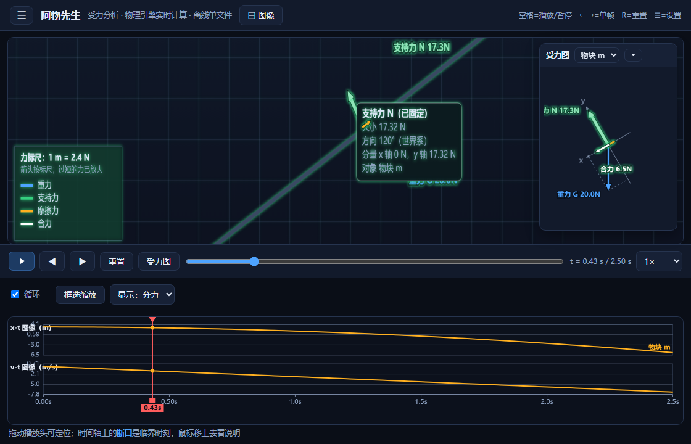
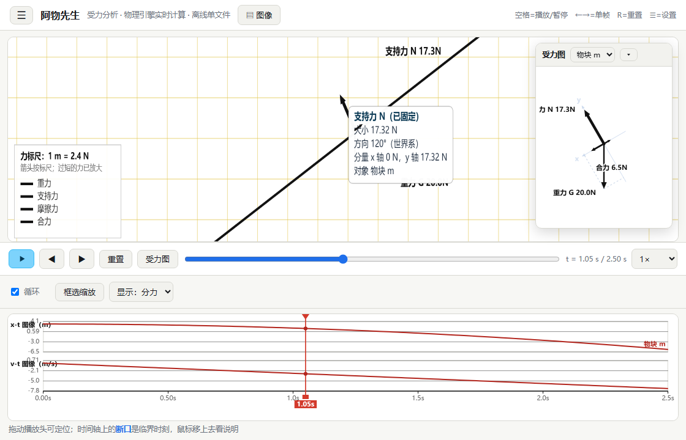

# 阿物先生 MrAwU — 物理受力分析动画生成器

> **识别图片，把中学阶段的物理题目中的模型可视化。**
>
> 具体形态：一张题图 → 会动、能验算的受力动画。单文件 HTML，离线可用，每一帧的力都有数值，并与解析解对照。
>
> AI 参与情况、责任归属与会话记录查阅方式见 [AI_DISCLOSURE.md](AI_DISCLOSURE.md) ｜ 许可证：[MIT](LICENSE)

**English (brief)** — *MrAwU* turns a physics problem photo into an interactive force-analysis
animation packaged as **one offline HTML file** (no Node/Python/network needed to view it).
Force vectors are drawn at the centre of mass, every frame satisfies Newton's second law within
0.5 %, and results are checked against analytic solutions. It runs on a self-written
velocity-Verlet integrator; Planck.js is used only as an independent cross-check during testing
(never shipped in the deliverable). Developed in human–AI pairing sessions — see
[AI_DISCLOSURE.md](AI_DISCLOSURE.md). Licensed under MIT. Issues:
<https://github.com/salicylate350234/MrAwU/issues>

## 界面预览

| 深色模式（斜面：沿斜面建系 + 正交分解） | 浅色模式（教材画法：黑色箭头） |
|---|---|
|  |  |

图中演示了三个核心能力：

1. **受力小窗**（右上角）——把该物体受到的各个分力**平移到同一作用点**，并按题型建系做正交分解；
2. **悬停 / 点击力箭头**——像桌面 tooltip 一样弹出该力的属性（大小、世界系方向、在分析坐标系下的两个分量、作用对象），点击可**固定**，选中的力会**变亮加粗**；
3. **解析值 vs 仿真值**（下边栏）——左边公式算的、右边引擎算的，附误差，逐个模型可查。

---

## 一、给最普通的情况：只想看、只想用

**你需要的只有一件事：一个浏览器（Edge / Chrome / 微信内置浏览器都可以）。**

1. 拿到 `阿物先生.html` 这一个文件（约 400 KB）。
2. **双击它**。
3. 完事。

不需要安装 Node.js，不需要安装 Python，不需要联网，不需要服务器，
不需要把文件放到某个特定目录，从 U 盘、微信、邮件附件里直接打开都行。

> 手机上也能看：把 HTML 文件传到手机，用浏览器打开即可（播放器会自动改成上下布局）。

### 怎么用

**左栏默认收起**：点左上角的 **⚙ 齿轮**打开设置抽屉（模型 / 参数 / 标注 / 图层），
点空白处、按 Esc 或点「关闭 ✕」收起。这样画布能占满整个窗口，图形看得更清楚。

| 操作 | 说明 |
|---|---|
| 左上 **⚙ 齿轮** | 打开/收起设置抽屉 |
| 抽屉里的「模型」下拉 | 切换模型。**针对某一题生成的版本里只有该题对应的模型**，不会混进无关题型 |
| 抽屉里的滑杆 | 拖动即重算。改倾角、质量、摩擦因数、带速、初速度…动画和受力立刻跟着变 |
| 播放 / 上一帧 / 下一帧 / 重置 | 逐帧讲解时特别有用；也可以拖时间轴任意定位 |
| **显示：分力 / 合力 / 速度**（画布下方右侧） | **三选一，一次只画一种箭头**，画面最干净。分力＝重力/支持力/摩擦力/绳张力/外力；合力＝ΣF；速度＝运动速度矢量（从物体边缘起画、虚线，以区别于力） |
| 1× / 0.5× / 0.1× | 放慢速度讲碰撞瞬间、讲共速时刻 |
| **主题**（齿轮里） | 深色（屏幕演示）／**浅色（教材试卷风格：白底、淡黄护眼网格、物体黑框空心、力全黑箭头、合力白空心箭头）** |
| **标注 · 文字三档**（齿轮里） | `完整`=力的名称+数值；`仅数值`；`关闭文字` |
| 标注 · 字号 / 图层开关 | 字号 8~18px 可调；网格、轨迹、图例、数据条、尺寸标注可分别开关 |
| 空格 / ← → / R | 键盘快捷键：播放暂停 / 单帧 / 重置 |
| 力标尺 | 画面左下角写着「1 m 长度 = X N」，箭头长度就是按这个比例画的，可以量 |

### 画布下方的 x-t / v-t 图像

两个图**共用一条平铺在最下方的时间轴**，横轴是时间：

| 元素 | 说明 |
|---|---|
| 上图 x-t | 各物体的位置—时间图像（竖直运动的题自动改成 y-t） |
| 下图 v-t | 各物体的速度—时间图像；共速、碰撞这种情况能直接看出曲线汇合或跳变 |
| **播放头** | 红色竖线 + 顶部小三角 + 底部时间标签，和剪辑软件的播放头一样，**在图上按住拖动就能定位**（比拖下面的进度条更直观） |
| 曲线末端名字 | 每条线右端标着是哪个物体（物块 m / 木板 M） |
| **时间轴断口** | 有临界时刻的模型（共速、撤去外力、碰撞、落地…）会把时间轴**断开一点**并标出名字；**鼠标移上去自动弹出该时刻的物理说明**（含代入数值的解释），点击可以钉住 |

模型可以在场景里给出临界时刻（`markers`），例如板块/传送带的「刚好共速」、碰撞的「碰撞瞬间」、自由落体的「落地」。
说明文字由模型用自己的解析解生成，所以里面带的数值和图上曲线是同一套数。

> 页面底部原本的「解析值 vs 仿真值」和「当前帧受力表」两张表已按需求移除。
> 自我检验并没有取消：构建时 `node node/tests.mjs` 仍然强制全绿，
> 画布右上角的数据条也一直显示 **受力残差**（正常 0.000%），
> 需要看逐项对照时用 `node node/sim.mjs --model <id>` 打印报告。

### 颜色约定

| 颜色 | 含义 |
|---|---|
| 蓝 | 重力 G |
| 绿 | 支持力 N |
| 橙 | 摩擦力 f |
| 紫 | 绳张力 / 杆的约束力 T |
| 红 | 外加力 F |
| 白 | 合力 ΣF（深色下带薄黑边；**浅色下也是普通黑色实心箭头**，只是线宽略粗一点作为区分） |

深色模式下**每支力箭头都描了一圈薄黑边**，所以在深色网格上、或者多支箭头叠在一起时都看得清。
速度矢量用的是普通箭头（不描边、不空心），因为「分力/合力/速度」是**三选一**显示的，不会混淆。

**画布按至少 2 倍超采样渲染**：即使老师用的是 1× 的普通 1080p 屏，文字和箭头也以 2 倍分辨率光栅化
再由浏览器缩小显示，边缘明显更锐利（3× 屏就按 3 倍，最高 3 倍）。实测 1× 屏下画布后备缓冲为
`2296×876` 而 CSS 尺寸 `1148×438`，正是 2 倍。

支持力和摩擦力画在**真实接触点**上，方向是真实法向和切向，不是随手画的斜箭头。
（屏幕上仍然统一从重心起画，见上一节说明。）

---

## 二、分发方式（给同事、给其他老师）

任选一种，都不需要对方装任何东西：

1. **发文件**：微信/QQ/邮件把 `阿物先生.html` 发过去，对方双击即可。
2. **U 盘**：拷进去，教室电脑双击即可（**教室没有网络也能用**，这点对公开课很重要）。
3. **放学校网站 / 云盘 / 内网**：把文件传上去，给一个链接。因为它是纯静态单文件，
   不需要后端、不需要数据库，任何静态托管（校园网共享目录、GitHub Pages、对象存储）都能放。
4. **自己改内容再发**：用文本编辑器打开这个 HTML，最上面的 `<title>` 和 `<h1>` 可以改成你的课堂标题。
   （文件里的其他内容是压缩过的引擎代码，不要手动改。）

> 为什么能做到"一个文件搞定"？因为物理引擎（planck.js）、场景定义、渲染器、播放器
> 在构建时已经被**全部内联**进这个 HTML 了，运行时不做任何网络请求，
> 也不使用 ES module（`file://` 下会被浏览器拦），所以双击就能跑。

---

## 三、给我自己/开发者：本机运行与重新构建

需要 Node.js（本机上已有，路径见下）。**主流程不需要 npm install**。

```powershell
# 假设 NODE 是 node 可执行文件路径
$NODE = "<DSH 自带 node>\node.exe   （本机示例：C:\Users\<你的用户名>\.dsh\dsh-runtimes\dsh-primary-runtime\dependencies\node\bin\node.exe）"
cd <本目录>

# 0) 环境自检：列清单并逐项确认（换电脑后先跑这个）
& $NODE node\check-env.mjs

# 1) 看有哪些模型
& $NODE node\sim.mjs --list

# 2) 跑一个模型的数值报告（含受力表、解析对照、残差自检）
& $NODE node\sim.mjs --model incline --params '{\"theta\":37,\"mu\":0.25,\"mass\":5}'

# 3) 全库回归测试（必须 0 失败）
& $NODE node\tests.mjs

# 4) 受力可见性审计（确认没有"非零却画不出来"的力，例如被压得太短的摩擦力）
& $NODE node\audit.mjs

# 5) 一条命令出全部交付物：测试 + 审计 + 单文件 HTML + 两个 zip
& $NODE node\package.mjs --title "阿物先生 · 物理受力动画演示器"
#    → dist/阿物先生-交付包/（HTML + 使用说明 + 详细说明 + 环境清单）
#    → dist/阿物先生-交付包.zip、dist/阿物先生-源码包.zip

# 6) 把关键帧渲染成 PNG（目视自检用；需要可选的 @napi-rs/canvas）
& $NODE node\qa.mjs --model belt --times 0.3,1.0,2.0
```

### 只要一个模型的精简版

在 `browser/template.html` 的模型下拉里切换即可——打包版默认包含全部模型，
单文件也只有约 400 KB，实际没必要裁剪。

### 加一个新模型

见 `SKILL.md` 的「新增模型契约」。要点：写 `build(p)` 生成场景 + `expect(p)` 给出解析解与测量探针，
然后在 `node node/tests.mjs` 里加参数组合，跑到全绿。

---

## 四、它算得准不准？

每个模型都自带解析解对照，打开页面右下方就能看到，例如：

| 模型 | 对照量 | 实测误差 |
|---|---|---|
| 斜面滑块 | a = g(sinθ−μcosθ)、N = mgcosθ、f = μN | 0.000% |
| 斜面 + 水平推力 | a、N = mgcosθ+Fsinθ、f = μN | 0.000% |
| 自由落体 | a = g、v = gt | 0.000% |
| 传送带 | a = μg（相对滑动阶段）、N = mg | 0.000% |
| 板块模型 | a₁ = −μ₁g、a₂ = [μ₁mg−μ₂(m+M)g]/M、动量守恒 | < 0.09% |
| 板块模型（拉木板·限时力） | 临界 F₀、a₁/a₂、相对滑动位移 Δx、最小板长 L_min | < 0.07% |
| 连接体 | a = F/(m₁+m₂)、T = m₁a | 0.000% |
| 滑轮（Atwood） | a = (m₁−m₂)g/(m₁+m₂)、T = 2m₁m₂g/(m₁+m₂) | 0.000% |
| 弹簧振子 | T = 2π√(m/k)、最大回复力 kA | < 0.2% |
| 平抛与斜抛 | 水平 a = 0、竖直 a = −g、射程与落地时间 | 0.000% |
| 圆周运动（竖直面·杆） | 最低点 mg+mv₀²/L、最高点 mv_top²/L−mg、v_top² = v₀²−4gL | < 2%（见下注） |
| 碰撞与冲量 | v₁′、v₂′、动量守恒、冲量 I = m₂v₂′ | 0.000% |
| 三力平衡 | 两绳张力解析解、合力为零 | 0.000% |

> 圆周运动那一行误差偏大是**步长离散误差**：planck 的刚性杆（DistanceJoint）每步把速度投影回
> 切线方向，这个投影会线性地耗散机械能（步长 1/240 时半圈掉 9%，加密到 1/3840 后约 1.5%）。
> 该模型因此单独用了 64 个子步。其余模型在默认步长下都是 0.000% 量级。

另外还有一个更严格的机器自检：**受力分解残差 |ΣJ − Δp|**，
也就是"画出来的所有力的冲量之和"与"动量实际变化量"之间的相对偏差。
它每一帧都算，画在画面右上角。正常情况是 0.000%，接近 100% 就说明受力方向画错了。

### 已知边界（如实说明）

- **只支持二维平面力学**。圆锥摆、三维力系做不了。
- 同样是二维的限制：**"水平面内的匀速圆周运动"做不了**——那是俯视图问题，搬到二维侧视图里
  就退化成沿一条直线来回运动（小球在最低点接触地面时切向速度恰好竖直，会被地面吃掉）。
  转盘上的物块同理（需要垂直于屏幕的转轴与盘面摩擦耦合）。所以圆周运动只提供
  **竖直面内杆约束**这一种二维下物理忠实的形态，这恰好也是中学最常考的类型。
- 竖直**圆轨道内壁**（水流星/过山车）暂未提供：内壁只能用内接多边形近似，
  小球滚过顶点时会"撞台阶"产生虚假冲量，做不出干净的受力图。有把握了再加。
- 碰撞瞬间的接触力是冲量折算的平均力，会随求解步长变化；平滑过程（斜面、连接体、简谐）精度最高。
- 绳子按理想无质量绳处理；弹簧是显式的 `F=−kx−cv`，存在极小的离散误差。
- 静摩擦是求解器的接触约束，非常接近临界角（μ≈tanθ）时会有微小抖动，属正常现象。
- 快速转动（竖直圆周）的机械能会有约 1.5% 的离散损耗，已在模型里用加密步长压到最小并如实标注。

---

## 五、常见问题

**双击后是空白 / 一片黑？**
极少见，通常是浏览器太旧。用 Edge 或 Chrome 打开即可，具体版本要求见第六节。

**能不能在手机上改参数？**
可以，滑杆和下拉都支持触摸。画面会自动改成上下布局。

**能不能录成视频发班级群？**
两种办法：① 用系统自带的录屏（Win+G / 手机录屏）边播边录；
② 用 `node node/qa.mjs` 导出关键帧 PNG，或用可选依赖导出 GIF。

**能不能加我自己的题目？**
可以。这个文件的生成流程是：题目图片 → 识别建模 → 物理引擎计算 → 生成 HTML。
新增题型后重新执行 `node node/build.mjs`，把新的单文件 HTML 发出去即可。

**为什么这个 HTML 有 400 KB？**
里面内联了完整的二维物理引擎——本项目**自研**的 velocity-Verlet 积分器（`lib/verlet.js`）。
换来的是：不联网、不装任何东西、双击就能算出真实的受力和运动。
（`vendor/planck.min.js` 只在 Node 侧做对拍复核用，**不进入**交付文件。）

---

## 六、版本兼容性声明

> 下表刻意区分「**实测**」与「**按语法推断、未实测**」，不把推断说成验证结论。

### 6.1 交付物 `阿物先生.html`（老师端）

| 项 | 要求 | 依据 |
|---|---|---|
| 浏览器 | **Edge / Chrome 49+、Firefox 45+、Safari 10+**（语法推断，未逐版本实测）<br>**已实测：Edge 155.0.4283.45（Windows，无头模式）** | 交付物语法以 ES5 为主，只用到少量 ES2015 特性（`let`、模板字符串、`Object.assign`），加 Flexbox 与 Canvas 2D。`globalThis` 全部写成 `typeof globalThis !== 'undefined' ? globalThis : this`，已做兼容判断，**不构成 ES2020 硬性要求** |
| 明确不支持 | **IE 全系** | 依赖 Flexbox 与 Canvas 2D；模板字符串属 ES2015 |
| 操作系统 | Windows / macOS / Linux 均可（纯 `file://` 打开，无本地依赖） | 仅在 Windows 上实测 |
| 网络 | **完全不需要**：无外链、无 CDN、无在线字体、无任何网络请求 | 构建期的自包含检查强制校验 |
| 运行时依赖 | **无**：不需要 Node.js、Python、Electron 或任何安装 | 交付物就是单个 HTML 文件 |
| 本地存储 | 用 `localStorage` 记住主题（键名 `mrawu-theme`）；隐私模式下自动降级为不记忆，不报错 | 代码中已用 try/catch 包裹 |
| 屏幕 | 建议 ≥ 1024×700；更小窗口自动切换上下布局，面板可折叠 | 实测 1400×1000 |

### 6.2 开发工具链 `node/*`（维护者端）

| 项 | 要求 | 依据 |
|---|---|---|
| Node.js | **≥ 16.7.0**（**已实测 v24.21.0**） | 用到 `fs.cpSync`（Node 16.7.0 起提供）；`fs.rmSync` 需 14.14+；`.mjs` 走 ESM |
| 可选依赖 | `@napi-rs/canvas` ^1.0.11，**仅**导出 GIF / 预览 PNG（`node/qa.mjs`）时需要 | 未安装时相关脚本自动跳过，其余功能不受影响 |
| 打包依赖 | 调用 Windows 自带的 `powershell` + `Compress-Archive` 生成 zip | `node/package.mjs`；非 Windows 环境需改用其它压缩方式 |
| DSH 客户端 | 本 skill 在 DSH 会话中开发与验证；**未绑定特定 DSH 版本** | — |

### 6.3 数据格式与引擎后端

| 项 | 当前版本 | 兼容策略 |
|---|---|---|
| 场景 JSON `schema` | `mrawu/scene@1` | **只增字段不提升版本号**（向后兼容）；**不兼容的字段变更必须提升到 `@2`**，并在本 README 记录迁移说明 |
| 物理引擎后端 | 默认 `verlet`（自研，交付物唯一使用） | `--engine planck` 可生成对照版，**仅供自测**，不用于交付 |
| 主题存储键 | `mrawu-theme` | 改键名会使旧用户丢失主题偏好（仅影响观感） |

### 6.4 兼容性承诺的边界（如实说明）

- 上表"推断可用"的浏览器版本**没有逐版本实测**，只验证了语法层面不存在更高版本的硬依赖。
- **未做 iOS / Android 实机测试**：触摸交互已实现，但未在移动设备上验证。
- 本项目**不做跨版本行为一致性承诺**：模型算法与积分步长可能在新版本中调整，同一道题在不同版本下
  末位数字允许有差异；但解析解对照误差始终 < 0.5%（见第四节）。

---

## 七、许可证

本项目采用 **MIT 许可证**，全文见同目录 [`LICENSE`](LICENSE)。

- 允许自由使用、修改、再分发（含商用与课堂教学），只需保留版权声明与许可声明。
- 版权所有者：**水杨酸盐**（[github.com/salicylate350234](https://github.com/salicylate350234)）。

### 第三方组件

| 组件 | 版本 | 许可 | 用途与分发 |
|---|---|---|---|
| Planck.js | 1.5.0 | MIT（© Erin Catto, Ali Shakiba） | **仅**用作 Node 侧自检对拍（`node/compare-engines.cjs`）；源码包内含 `vendor/planck.min.js`，**交付给老师的 HTML 不含它** |
| @napi-rs/canvas | ^1.0.11 | MIT | 可选开发依赖（导出 GIF / 预览 PNG），**不随包分发** |

AI 参与情况、责任归属与会话记录查阅方式，见 [`AI_DISCLOSURE.md`](AI_DISCLOSURE.md)。

---

## 八、维护者与反馈

| 项 | 内容 |
|---|---|
| 维护者 | **水杨酸盐**（[@salicylate350234](https://github.com/salicylate350234)） |
| 问题反馈 / 功能建议 | <https://github.com/salicylate350234/MrAwU/issues> |
| 会话记录查阅请求 | 同上 Issues，标题注明「会话记录查阅」，说明用途与范围 |
| 责任归属 | 见 [`AI_DISCLOSURE.md`](AI_DISCLOSURE.md)：**人类维护者对发布内容承担全部责任** |

欢迎提交 issue 与 PR。提交前请先跑一遍回归：

```bash
node node/tests.mjs        # 必须 0 失败
node node/audit.mjs        # 必须 19/19
node node/compare-engines.cjs   # 必须 25/25
```
